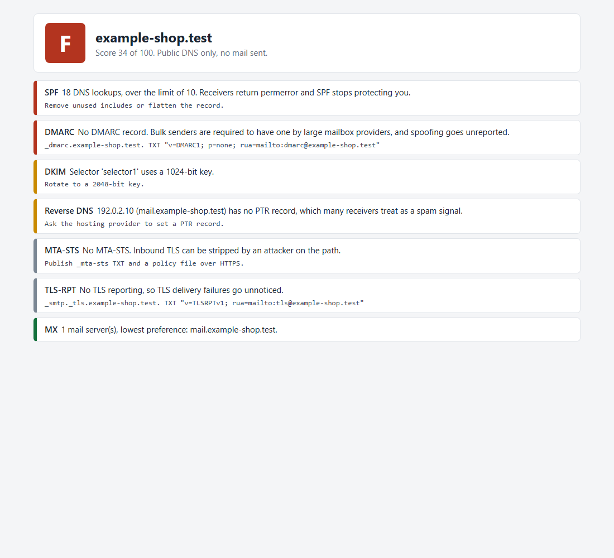

# Email Deliverability Checker

Why does mail from your domain land in spam, or why can anyone send as you? This tool reads a domain's public DNS and answers in plain words, with the exact record to publish for each problem.



## What it checks

- **SPF:** missing or duplicate records, the dangerous `+all`, and the limit of 10 DNS lookups, counted through nested includes. A record over the limit fails silently at the receiver, and it's the fault people most often miss.
- **DKIM:** tries 15 common selector names and reads the key size from the record. A key under 2048 bits is flagged, and a revoked selector isn't called a problem.
- **DMARC:** policy, partial percentages and the report address.
- **MX and transport:** mail hosts without addresses, reverse DNS that doesn't match, MTA-STS and TLS reporting.

It only reads public DNS. It sends no mail and touches nothing on your servers.

## Use

```bash
pip install -r requirements.txt
python check.py example.com --html report.html
```

Add `--selector name` if you know your DKIM selector from the header of a sent message.

## Tests

14 tests against exact DNS answers, including include loops and over-limit SPF chains: `pytest`. I also ran it against real public domains to check the lookups and key sizes on live records.

## Limits

DKIM selectors can't be listed through DNS, so a key under an unusual name shows as not found, and the report says so. The tool reads configuration, not reputation. Blocklists, content and sending patterns need their own checks.
